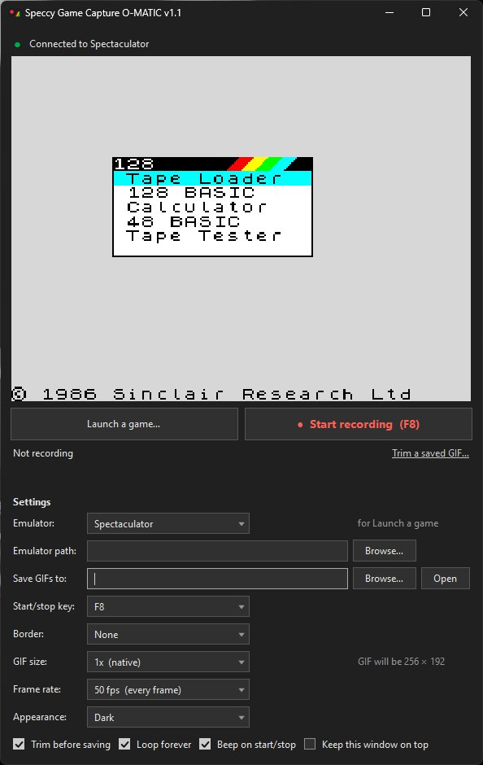
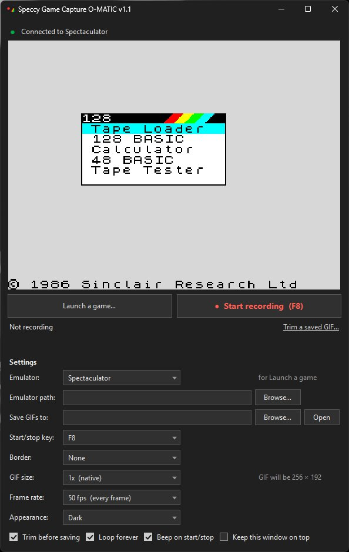
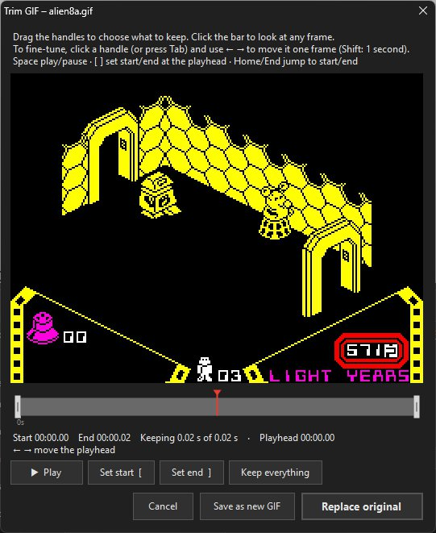
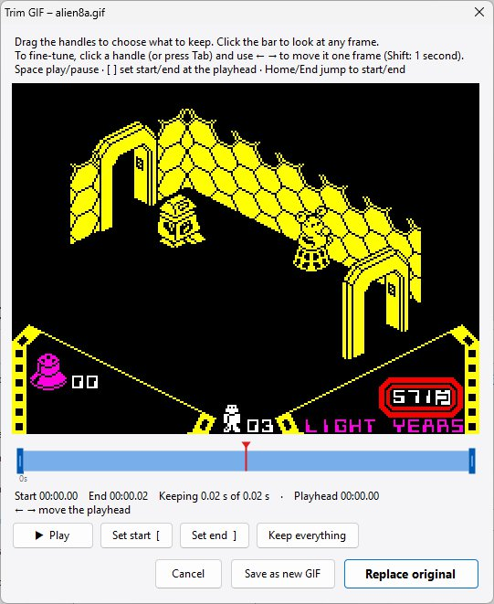

# Speccy Game Capture O-MATIC

Records your ZX Spectrum gameplay in **Spectaculator** or **Fuse** as an animated GIF, at
the Spectrum's real resolution (256 × 192), with no emulator window, menus or display
filters in the picture. The border can be included if you want it.

<p align="center">
  
  &nbsp;
  
</p>

## Download

Get the latest zip from the [Releases page](https://github.com/manic232/Speccy-Game-Capture-O-MATIC/releases/latest)
and unzip it into any folder. There's no installer.

- Runs on Windows 10 and 11, using the .NET Framework 4 that's already part of Windows.
- Works with **Spectaculator 9.1** and **Fuse 1.10.1** (the standard Windows build).
- The program isn't code-signed, so Windows may say "Windows protected your PC" the first
  time. Click **More info**, then **Run anyway**. You can also build it yourself from the
  source (see the end of this page).

## Using it

1. Run **`Speccy Game Capture O-MATIC.exe`**.
2. Choose your **Emulator** in Settings, click **Launch a game…** and pick a `.tzx`, `.tap`,
   `.z80`, `.sna`, etc. You can also start the emulator yourself; the app finds it either
   way. When the status dot turns green, the preview shows exactly what will be recorded.
3. Play. Press **F8** to start recording and **F8** again to stop. This works while the
   emulator has focus, so you don't need to switch windows. You'll hear a rising beep
   on start and a falling beep on stop. Changed your mind? **Cancel recording** (next to
   the recording time) stops and throws the clip away without asking.
4. The **trim window** opens (see below). Choose the part to keep and click **Save GIF**.
5. The GIF is saved to the `GIFs` folder next to the app as `<game name>_<date>_<time>.gif`.
   Use **Open GIF** or **Show in folder** to find it.

### Spectaculator and Fuse

Recording works with whichever of the two is running; the **Emulator** setting only picks
which one **Launch a game…** uses. The status line says which one is connected.

- **Both open?** The app records the one you used last. Click into the other emulator's
  window and the app switches to it within a second (never in the middle of a recording).
- **Launching into Fuse.** Spectaculator loads the game into its open window, but Fuse can't
  be told to do that from outside. If Fuse is already open, the app offers to close it first
  (Fuse asks "Exit Fuse?") or to open a second Fuse window.
- **F7/F8 in Fuse.** Fuse uses F7 to open a tape and F8 to play one. While this app is running
  with F8 as its start/stop key, F8 starts and stops recording instead. If you play tapes by
  hand, pick **Shift+F8** or **Scroll Lock** as the start/stop key.
- **Colours.** Each emulator's own colours are used, so GIFs match what you see. Fuse draws
  normal colours a little darker than Spectaculator.
- **Border.** Fuse only draws 32 pixels of border at the sides and 24 above and below, so
  with Fuse the larger border settings give Fuse's whole border (320 × 240) and no more.

### Window size

Drag the window's edges (or maximise it) to make it bigger or smaller. The preview grows
or shrinks to fill the space, keeping the Spectrum's shape, and the path boxes stretch.
At its smallest, the preview shows the picture at its real size. The app remembers the
window's size and position, and whether it was maximised, for next time. If the screen
it was on is no longer connected, it opens in the middle of the main screen instead.

### Portable

Everything stays in the app's own folder. Nothing goes in the registry or AppData.

- `settings.ini` sits next to the .exe. It's plain `Name=Value` text. Close the app
  before editing it by hand, or delete it to go back to the default settings.
- GIFs go to the `GIFs` folder next to the .exe, unless you choose another folder.
- Paths inside the app's folder are stored relative to it, so you can move the folder,
  copy it to another PC, or run it from a USB stick with a different drive letter.
- If the folder can't be written to (for example inside Program Files), settings fall
  back to `%APPDATA%\Speccy Game Capture O-MATIC`.

### Trimming

When you stop recording, the clip opens in the trim window so you can cut the dead
bits off the start and end.

<p align="center">
  
  &nbsp;
  
</p>

- **Drag the blue handles** on the timeline to set the start and end. Grey parts are cut.
- **Click anywhere on the timeline** to view that frame. The red marker is the playhead.
- **Fine-tune with the arrow keys.** Click a handle (or press Tab) and it gets an outline.
  ← and → then move that handle one frame at a time, and the preview shows the frame
  at the cut. Press Esc to go back to moving the playhead.
- **Play** loops the kept section, just as the finished GIF will.

| Key | Action |
|---|---|
| Space | Play / pause |
| ← / → | Move the playhead, or the selected handle, one frame (hold Shift for one second) |
| Tab | Switch between the playhead, the start handle and the end handle |
| Esc | Back to moving the playhead |
| [ / ] | Set the start / end at the playhead (and select that handle) |
| Home / End | Jump to the start / end |
| Enter | Save GIF |

**Keep everything** resets the handles. **Discard recording** throws the clip away
after asking you to confirm. To skip this step and save straight away, untick
**Trim before saving**.

#### Trimming a GIF you've already saved

Forgot to trim, or want a shorter version? Click **Trim** next to the GIF you just saved,
or **Trim a saved GIF…** to pick any GIF made by this app. It opens in the trim window,
and when you're done:

- **Replace original** saves over it. The old file goes to the Recycle Bin, so you can
  get it back. If the GIF is open in another program and can't be replaced, the trimmed
  version is saved as a copy instead.
- **Save as new GIF** keeps the original and saves `<name>_trimmed.gif` next to it.

The GIF keeps its own size, frame rate, colours and loop setting, whatever the
current settings are. Only GIFs made by this app can be opened, because the app
needs to know their Spectrum resolution and colours.

### Settings

| Setting | What it does |
|---|---|
| Emulator | Spectaculator or Fuse: the one **Launch a game…** opens games in. |
| Emulator path | Where that emulator's .exe is. Each emulator remembers its own. |
| Start/stop key | F8 by default. F7, Shift+F7, Shift+F8 or Scroll Lock are also offered. Spectaculator already uses F1–F6, F9–F12 and Pause. Fuse uses F7 and F8 for tapes, and a note appears if your key takes one over. |
| Border | None (just the 256 × 192 screen), or 16 / 32 / 48 pixels of border on each side. Border colour changes, such as loading stripes and split borders, are reproduced line by line. Fuse's border is at most 32 px at the sides and 24 px above and below. |
| GIF size | 1x = native. 2x/3x/4x scale up with sharp pixels, which is handy for sites that shrink small images. The final size is shown next to it. |
| Frame rate | 50 fps keeps every frame. Lower rates make smaller files. |
| Appearance | **Dark** (neutral greys and black), **Light**, or **Match Windows**, which follows Windows' light/dark app setting and switches automatically when that changes. |
| Trim before saving | Opens the trim window after each recording. |
| Loop forever | Off = the GIF plays once. |

## How it works

Most screen recorders grab the window. That would pick up the emulator's scaler,
scanlines and TV filter, and the window edges. This app reads the finished frame
directly from the emulator's memory instead (read-only, nothing is changed). Every
emulated frame is picked up exactly once, 50 times a second.

- **Spectaculator:** the app reads the same bitmap, colour data and list of border colour
  changes the emulator draws from, and builds the picture from those.
- **Fuse:** Fuse keeps a finished picture (screen plus border, one colour number per pixel)
  and a frame counter. The app waits for the counter to tick and copies the picture
  straight after Fuse finishes drawing it.

- **No dropped or doubled frames.** GIF timing is in emulator time (1 frame = 20 ms).
- **No filter effects.** The output is identical whatever display effects you use.
- **Paused time is skipped.** If you pause the emulator mid-recording, the gap isn't recorded.
- **Small files.** Repeated frames are merged, and each frame stores only the pixels
  that changed. 8 seconds of Alien 8 at 50 fps came to about 11 KB. Busy borders,
  such as loading stripes, make files much larger.

## Limitations

- Tested with **Spectaculator 9.1** and **Fuse 1.10.1** (the standard 32-bit Windows
  build). The app recognises each emulator's display by its layout in memory. A future
  version could change that layout, and then the app would say it can't find the screen
  or stay on "Waiting…".
- Spectaculator: the border is drawn using 48K timing. On 128K/+2/+3 models, mid-screen
  border effects can sit a line or two away from where Spectaculator shows them. A plain
  border colour is always right. (Fuse draws its own border, so it's always exact.)
- Spectaculator: flashing colours (FLASH) flash at the correct rate, but may not be in step
  with the emulator's own flash timing. (In Fuse they're exact.)
- Standard Spectrum colours only. ULAplus palettes and Timex hi-res modes aren't
  reproduced, and Fuse's Timex machines (TC2048, TC2068, TS2068) aren't supported.
- Fuse can take a few seconds to connect after loading a game, because it runs at top
  speed while a tape loads.

## Building from source

There's nothing to install. `build.cmd` uses the C# compiler that ships with Windows
(.NET Framework 4.x) and produces the .exe in this folder.

```
build.cmd
```

- `src/Program.cs`: start-up, and the version number (shown in the title bar and the .exe's properties)
- `src/EmulatorSource.cs`: what every emulator link provides, and finding running emulators
- `src/SpectaculatorReader.cs`: finds and reads Spectaculator's display buffer and border data
- `src/FuseReader.cs`: finds and reads Fuse's finished picture and frame counter
- `src/CaptureEngine.cs`: background capture thread, Spectrum screen and border rendering, recording
- `src/GifWriter.cs`: animated GIF encoder (LZW, changed-area frames, transparency, trimming)
- `src/GifReader.cs`: reads a saved GIF back in so it can be trimmed again
- `src/TrimForm.cs`: the trim window and timeline
- `src/Theme.cs`: light/dark colour schemes, themed drop-downs, progress bar and prompts
- `src/MainForm.cs`: the main window, preview and hotkey
- `assets/app.ico`: the app's icon
- `images/`: the screenshots on this page

## Licence

MIT. See [LICENSE](LICENSE). Spectaculator and Fuse belong to their own authors, and this
app isn't connected with either of them.
